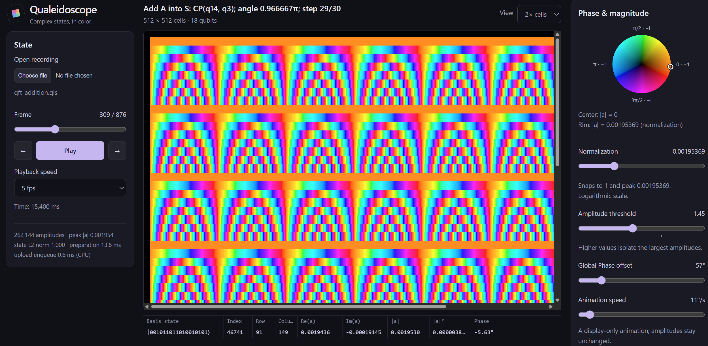

# Qualeidoscope

A small WebGPU viewer for complex amplitudes as a square of colored cells.
Supports even qubit counts from 0 to 20 (up to a 1024 × 1024 grid).



## Run the viewer

```sh
python3 qualeidoscope.py
```

Open [localhost:8000](http://localhost:8000) in a browser with WebGPU enabled.
In **State → Open recording**, choose a `.qls` file from disk in the examples folder.

## Write recordings from Python

The writer uses only the standard library:

```python
from math import sqrt
from qls import Frame, write_qls

write_qls("bell.qls", [
    Frame([1, 0, 0, 0], timestamp_ms=0, title="Initial"),
    Frame([1/sqrt(2), 1/sqrt(2), 0, 0], timestamp_ms=100, title="Hadamard"),
    Frame([1/sqrt(2), 0, 0, 1/sqrt(2)], timestamp_ms=200, title="Bell"),
], n=2)
```

Open `bell.qls` in the viewer. Snap Normalization to the peak to use the full color
range for small amplitudes; this does not renormalize the state.
